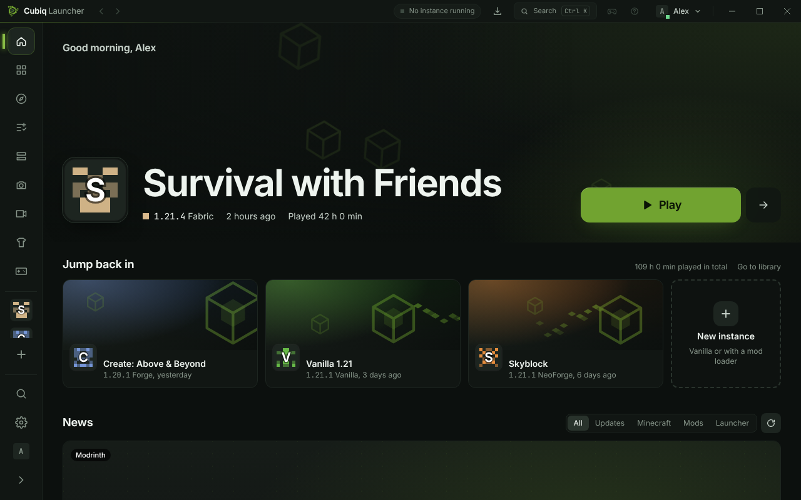

<div align="center">

[English](README.md) · [**Deutsch**](README.de.md)


# Cubiq Launcher

**Ein schneller, moderner Launcher für Minecraft: Java Edition unter Windows und Linux – mit eingebautem Client für FPS-, HUD- und PvP-Funktionen.**

[](https://github.com/PwiePixel/Cubiq-launcher/releases)
[](LICENSE)
[](https://tauri.app)
[](https://nuxt.com)

[Download](https://github.com/PwiePixel/Cubiq-launcher/releases) ·
[Doku](https://github.com/PwiePixel/Cubiq-launcher/wiki) ·
[Funktionen](#funktionen) ·
[Vor dem ersten Release](#vor-dem-ersten-release) ·
[Selbst bauen](#selbst-bauen) ·
[Releases](#releases)



</div>

> [!NOTE]
> Der Cubiq Launcher ist noch früh in der Entwicklung (Version 0.1.0). Er ist freie Software unter der GPL-3.0;
> Copyright- und Drittanbieter-Hinweise stehen in [NOTICE](NOTICE).

## Funktionen

**Spielen**
- Jede Minecraft-Version von 1.5.2 bis zur neuesten, Snapshots eingeschlossen
- **Fabric, Quilt, Forge und NeoForge**, vom Launcher selbst installiert
- Java automatisch: Für jede Version wird die passende Mojang-Laufzeit geladen
- **Boost** – Vanilla-Instanzen starten auf Wunsch mit Fabric, dem Cubiq Client und bewährten Performance-Mods
  (Sodium, Lithium, FerriteCore, …); pro Instanz abschaltbar für echtes Vanilla
- Spiele laufen weiter, wenn du den Launcher schließt, und werden beim nächsten Start wieder erkannt

**Cubiq Client (Mod im Spiel)**
- Für Fabric/Quilt, Forge und NeoForge, wird in jede passende Instanz automatisch installiert
- Menü im Spiel (Rechte Umschalttaste), HUD-Editor, Minimap und Wegpunkte, Zoom, Freelook, Chat-Verbesserungen und
  PvP-Anzeigen
- Fair Play: keine Änderungen an Reichweite oder Hitboxen, kein Auto-Klicken; die Minimap zeigt nur geladene Chunks

**Inhalte**
- Mods, Modpacks, Ressourcenpakete, Datenpakete und Shader von **Modrinth** (und mit API-Schlüssel CurseForge)
  durchsuchen und installieren, Abhängigkeiten inklusive
- Instanzen aus dem offiziellen Launcher, der Modrinth App, CurseForge, Prism Launcher, MultiMC oder einem Ordner
  importieren
- Jede Instanz als `.mrpack` exportieren

**Alles andere**
- **Schlichtes Design** im Grün des Cubiq-Logos: dunkles, OLED-, helles oder System-Farbschema und sieben Akzentfarben
- Mehrere Microsoft-Konten, Tokens verschlüsselt auf deinem PC
- Hintergrundaufgaben mit Pause, Fortsetzen und Abbrechen, Serverliste mit Ping, Skins & Umhänge mit 3D-Vorschau,
  Screenshot-Galerie, Clips & Aufnahme (Windows), Absturz-Diagnose und Log-Teilen, Befehlspalette (Strg+K)
- **Leise, signierte Updates**, die beim nächsten Neustart installiert werden
- Optionale **Cubiq-Dienste** (Freunde, Chat, Umhänge, …) – sie brauchen einen eigenen Server und bleiben **aus**, bis
  einer eingetragen ist; siehe [PRIVACY.de.md](PRIVACY.de.md)

## Installation

### Windows

1. `Cubiq-Launcher_<version>_x64-setup.exe` von der [Release-Seite](https://github.com/PwiePixel/Cubiq-launcher/releases) laden.
2. Ausführen. Installiert wird nur für deinen Windows-Benutzer, ohne Administratorrechte.
3. Mit dem Microsoft-Konto anmelden, dem Minecraft gehört.

> [!TIP]
> Der Installer ist noch nicht code-signiert, deshalb zeigt Windows SmartScreen eventuell „Der Computer wurde durch
> Windows geschützt“. Dann **Weitere Informationen → Trotzdem ausführen** wählen.

Deine Daten liegen in `%APPDATA%\Cubiq-Launcher`.

### Linux

Jedes Release hat ein **AppImage**, ein **.deb** und ein **.rpm** für x86_64.

| Distribution | Installation |
|---|---|
| **Debian, Ubuntu**, Linux Mint, Pop!_OS | `sudo apt install ./Cubiq-Launcher_<version>_amd64.deb` |
| **Fedora**, openSUSE | `sudo dnf install ./Cubiq-Launcher-<version>-1.x86_64.rpm` |
| **Jede Distribution** | `chmod +x Cubiq-Launcher_<version>_amd64.AppImage && ./Cubiq-Launcher_<version>_amd64.AppImage` |
| **Arch Linux** | AUR-Rezepte in [`packaging/aur`](packaging/aur) (noch nicht veröffentlicht) |

Deine Daten liegen in `~/.local/share/Cubiq-Launcher`. Mehr in der [Linux-Anleitung](docs/wiki/de-Linux.md).

## Fair Play

- Anmelden geht **nur mit einem rechtmäßig erworbenen Microsoft-Konto** über den offiziellen OAuth-2.0-Ablauf von
  Microsoft.
- Es gibt **keinen Offline- oder „Cracked“-Modus**, und Besitzprüfungen werden nie umgangen.
- Spieldateien werden **nicht weiterverbreitet**, sondern direkt von Mojangs Servern auf deinen PC geladen.

## Vor dem ersten Release

Diese Werte gehören dir und werden beim Bauen eingetragen. Fehlt ein Wert, bleibt nur die jeweilige Funktion aus;
der Rest des Launchers läuft.

| Was | Wo | Ohne |
|---|---|---|
| **Microsoft-Anmeldung**: schon eingebaut – die Azure-App „Cubiq Launcher“ (Client-ID `5cc8876f-8fe1-4c27-bc28-9355a79db635`), funktioniert, sobald Microsoft sie [für die Minecraft-API freigegeben](https://aka.ms/mce-reviewappid) hat; Einrichtung und Antworten fürs Formular: [docs/microsoft-sign-in.md](docs/microsoft-sign-in.md) | Optional Repo-Variable `CUBIQ_MSA_CLIENT_ID` für eine andere Azure-App | – (bis zur Freigabe meldet die Anmeldung, dass sie darauf wartet) |
| **Update-Schlüssel**: schon erstellt (Schlüssel-ID `A427CF588D4DF86A`); der öffentliche Schlüssel steht in `src-tauri/tauri.conf.json` und `src-tauri/crates/core/src/client_mod_update.rs` | Secrets `TAURI_SIGNING_PRIVATE_KEY` (Inhalt der Schlüsseldatei) und `TAURI_SIGNING_PRIVATE_KEY_PASSWORD` | Installer ohne Update-Signatur – installierte Launcher aktualisieren sich nicht selbst |
| **Cubiq-Dienste** (Freunde, Chat, Umhänge, Creator-Codes, …): Basis-URL deines eigenen Servers mit der API | Repo-Variable `CUBIQ_API_BASE`; für den Mod im Spiel zusätzlich `DEFAULT_API` in `client-mod/common/src/main/java/dev/pwiepixel/cubiqclient/core/online/OnlineConfig.java` | Dienste ausgeblendet, es wird nichts gesendet |
| **Discord-Status**: Application-ID deiner Discord-App | Repo-Variable `CUBIQ_DISCORD_APP_ID` | Kein Discord-Status |
| **CurseForge**: API-Schlüssel aus der CurseForge-Konsole | Secret `CURSEFORGE_API_KEY` | Nur Modrinth |
| **Cubiq-Client-Jars**: `./gradlew collectLauncherJars` in `client-mod/`, dann `node scripts/publish-client-mod.mjs --dry-run` | `src-tauri/resources/client-mod/` (`builds.json` ist noch leer) | Kein mitgelieferter Mod im Spiel |
| **Doku**: die Seiten aus [`docs/wiki`](docs/wiki) ins GitHub-Wiki übernehmen | GitHub → Wiki | Hilfe-Links führen in ein leeres Wiki |
| **Android** (optional): Release-Keystore | Secrets `ANDROID_KEYSTORE_BASE64`, `ANDROID_KEYSTORE_PASSWORD`, `ANDROID_KEY_ALIAS`, `ANDROID_KEY_PASSWORD` | Unsignierte APK |

Lokal werden dieselben Werte beim Bauen aus gleichnamigen Umgebungsvariablen gelesen
(`CUBIQ_MSA_CLIENT_ID=… pnpm app:build`).

## Selbst bauen

**Voraussetzungen:** Node.js 22+ mit pnpm und Rust (stable). Unter Windows die Visual Studio Build Tools
(„Desktopentwicklung mit C++“) und WebView2, unter Linux die Entwicklungspakete für WebKitGTK/GTK:

```sh
# Debian/Ubuntu
sudo apt install build-essential curl file pkg-config libssl-dev libwebkit2gtk-4.1-dev libgtk-3-dev libayatana-appindicator3-dev librsvg2-dev libxdo-dev
# Arch
sudo pacman -S --needed base-devel webkit2gtk-4.1 gtk3 libayatana-appindicator librsvg openssl xdotool
# Fedora
sudo dnf install gcc-c++ openssl-devel webkit2gtk4.1-devel gtk3-devel libappindicator-gtk3-devel librsvg2-devel libxdo-devel
```

```sh
pnpm install
pnpm app:dev      # Nuxt-Entwicklungsserver + Tauri-Fenster mit Hot Reload
```

| Befehl | Zweck |
|---|---|
| `pnpm app:build` | Release-Build und Installer – unter Windows auch als `release/Cubiq-Launcher_<version>_x64-setup.exe`; signiert die Update-Dateien, wenn der Schlüssel in `~/.tauri/cubiq-launcher.key` liegt (Passwort in `cubiq-launcher.key.password`) |
| `pnpm typecheck` | TypeScript/Vue prüfen |
| `pnpm test` | Frontend-Tests (Vitest) |
| `cargo test --workspace` (in `src-tauri`) | Rust-Tests |
| `cargo clippy --workspace --all-targets` (in `src-tauri`) | Rust-Lints |
| `./gradlew collectLauncherJars` (in `client-mod/`) | Cubiq-Client-Jars für den Launcher bauen |

Mit `CUBIQ_LAUNCHER_HOME` nutzt der Launcher einen anderen Datenordner. Der Spielstart lässt sich ohne Oberfläche
testen:

```sh
cargo run -p cubiq-core --example launch -- <datenordner> 1.21.1 [vanilla|fabric|quilt|forge|neoforge] [sekunden]
```

## Releases

Releases entstehen von selbst. Nach jedem grünen CI-Lauf auf `main` prüft
[`auto-release.yml`](.github/workflows/auto-release.yml), ob sich seit dem letzten Release etwas für Spieler geändert
hat. Wenn ja,

1. erhöht der Workflow die Version (Commits mit `feat:` → Minor, `feat!:` → Major, alles andere → Patch),
2. schreibt den neuen Abschnitt in [CHANGELOG.md](CHANGELOG.md) auf Englisch und Deutsch – aus den Spieler-Texten in
   [`changes/`](changes/README.md) (eine Datei je Änderung), sonst aus den Commit-Nachrichten
   ([so geht's](CONTRIBUTING.md#release-notes)),
3. zeichnet das Bild des Release passend zum Text – eine kleine animierte Pixel-Art-Szene mit Cubi, dem Würfel aus
   dem Logo, z. B. neben einem Schraubenschlüssel für Fehlerbehebungen oder einer Rakete für einen Start
   (`scripts/release-art.mjs`); Launcher, Website und GitHub-Release zeigen es mit dem Update, dazu die Screenshots
   aus den Spieler-Texten,
4. committet „Release vX.Y.Z“, setzt das Tag und startet [`release.yml`](.github/workflows/release.yml).

`release.yml` baut den Windows-Installer (`Cubiq-Launcher_<version>_x64-setup.exe`), eine portable ZIP und die
Linux-Pakete und veröffentlicht sie als GitHub-Release „Cubiq Launcher X.Y.Z“ mit dem Changelog als Beschreibung –
denselben Text zeigt der Launcher nach dem Update („Was ist neu“). Mit dem Signaturschlüssel in den Secrets
aktualisiert er auch den Update-Kanal, sodass sich installierte Launcher selbst aktualisieren.

- **Status sofort:** Sobald der Build startet, steht auf der Release-Seite ein Entwurf „wird gebaut“. Fehlt am Ende
  der Windows-Installer, bleibt das Release ein Entwurf (nur für dich sichtbar) mit dem Grund ganz oben – ein
  fehlgeschlagener Build-Schritt mit seinen Fehlerzeilen, ein unvollständiger Abschnitt in CHANGELOG.md – und einem
  Link zum Log. Die Zusammenfassung des Laufs zeigt, was gebaut wurde, ob die Update-Signatur geklappt hat und warum
  etwas fehlt.
- **Signaturschlüssel:** wird vor dem Build geprüft (`scripts/check-signing.mjs`); Einfügefehler wie ein Zeilenumbruch
  am Ende werden automatisch korrigiert. Ein falscher Schlüssel oder ein falsches Passwort stoppt den Build nicht –
  der Installer entsteht ohne Update-Signatur, und die Zusammenfassung sagt, was nicht stimmt.
- **CI rot:** kein Release; der Lauf „Auto release“ heißt dann „Kein Release – CI …“ und nennt die fehlgeschlagenen
  Jobs.
- **Von Hand:** Actions → Auto release → Run workflow (Versionssprung wählbar) oder ein Tag wie `v0.2.0` pushen, zu
  dessen Version es einen Abschnitt in CHANGELOG.md gibt. Ein vorhandenes Tag neu bauen: Actions → Release → Run
  workflow.
- **Keine Merge-Konflikte:** Branches ändern nie `CHANGELOG.md` oder Versionsnummern, sondern legen nur Dateien in
  `changes/` an; [`pr-sync.yml`](.github/workflows/pr-sync.yml) mergt `main` nach jedem Merge in offene Pull Requests.
- **Release-Texte bleiben aktuell:** Ändert sich `CHANGELOG.md` oder ein Release-Bild auf `main`, schreibt
  [`release-notes.yml`](.github/workflows/release-notes.yml) die betroffenen GitHub-Releases neu.
- **Pausieren:** Repo-Variable `CUBIQ_AUTO_RELEASE` auf `false` setzen.
- **Geschützter `main`:** Dürfen nur Pull Requests `main` ändern, wird der Release-Commit abgelehnt – dann GitHub
  Actions von dieser Regel ausnehmen.
- Screenshots und ein eigenes Update-Banner sind freiwillig ([so geht's](docs/release-screenshots.md)).

## Aufbau

```
app/                    Nuxt-4-Oberfläche (SPA, kein SSR)
src-tauri/
  src/                  Tauri-App: Befehle, Aufgaben, Fehlerabbildung, Plugins
  crates/core/          cubiq-core: der von der Oberfläche unabhängige Kern (Metadaten, Loader, Start,
                        Anmeldung, Modrinth/CurseForge, Modpacks, Clips, Client der Cubiq-Dienste, …)
  plugins/              Spiel-Engine und Push für Mobilgeräte
  resources/client-mod/ Mitgelieferte Cubiq-Client-Builds + builds.json
client-mod/             Cubiq Client: gemeinsamer Kern + Fabric-, Forge- und NeoForge-Bäume
server-plugin/          Optionales Server-Plugin, das Funktionen des Cubiq Clients steuert
relay/                  Relay für das Welt-Hosting (Freunde treten deiner Einzelspielerwelt bei)
```

- **Die Logik steckt in `cubiq-core`**, die Tauri-Schicht bleibt dünn, und der Kern prüft jede Eingabe selbst.
- **Die Webview bekommt keine Datei-, Netzwerk- oder Shell-Rechte.** Alles läuft über eigene Befehle, unter einer
  strengen CSP.

## Mitmachen

Beiträge sind willkommen – lies [CONTRIBUTING.md](CONTRIBUTING.md). Sicherheitsprobleme bitte vertraulich melden
(siehe [SECURITY.md](SECURITY.md)).

## Lizenz

Der Cubiq Launcher steht unter der [GNU General Public License v3.0](LICENSE).

Copyright (C) 2026 PwiePixel. Copyright- und Drittanbieter-Hinweise: [NOTICE](NOTICE). Teile der Prozessverwaltung stammen aus
[Polyfrost OneLauncher](https://github.com/Polyfrost/OneLauncher) (GPL-3.0-only).

<sub>Der Cubiq Launcher ist kein offizielles Minecraft-Produkt und weder von Mojang noch von Microsoft genehmigt oder mit ihnen verbunden.</sub>
